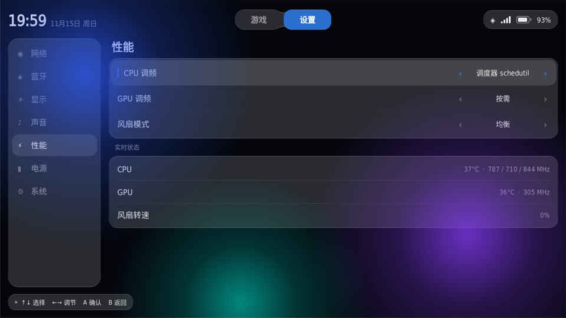
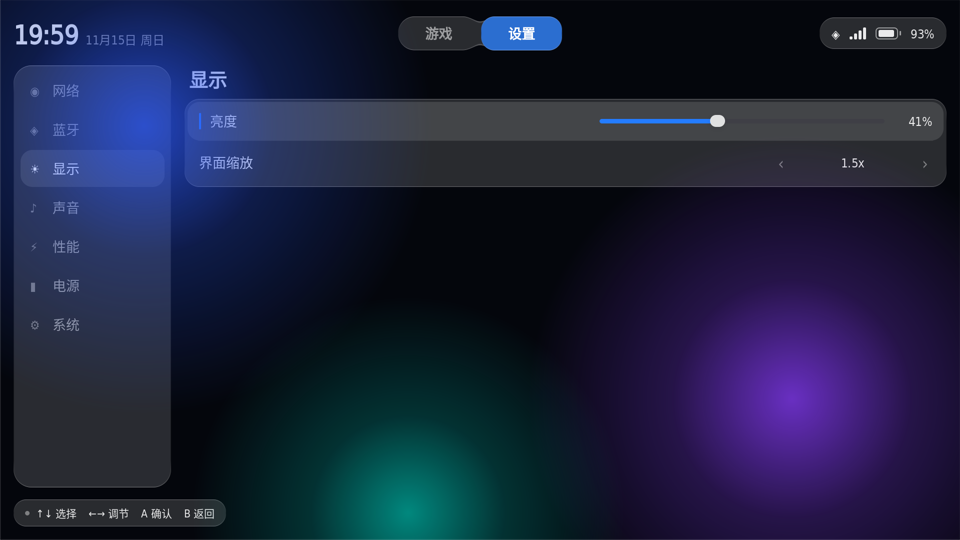

# mygo-pocket

A handheld launcher built on [MyGo](https://github.com/egoist/mygo). It replaces ROCKNIX's EmulationStation frontend with a
fullscreen MyGo native UI in a sway session of its own, and it runs MyGo apps as cards next to games. It is developed on a Retroid Pocket
Flip 2 (Snapdragon 865, ROCKNIX).


| Performance | Display |
| --- | --- |
|  |  |

- **Liquid Glass UI** after ColorOS 16 ([suqi8/coui](https://github.com/suqi8/coui)): MyGo's `glass` material, a dark scheme, and
  lights on the wallpaper that follow the chosen game's color. Game cards are 2:3 posters.
- **Cards come from directories.** Nothing is hard-coded. Each directory with a `pocket.json` is one card, so to install a game on another
  handheld you copy its directory over (see [Cards](#cards)).
- **MyGo ecosystem**: a MyGo app is a card of kind `mygo`. Its window opens fullscreen above the launcher in the same sway session. The
  launcher is itself a MyGo app.
- **System settings**:
  - Wi-Fi (scan, join with an on-screen keyboard, forget) and Bluetooth (pair, connect, forget).
  - Brightness, volume and UI zoom (1–2×, default 1.5× for 1080p).
  - Analog stick lights: off, battery level or a color, at any brightness. ROCKNIX's battery mode always lights them at full
    brightness, so the launcher holds the chosen brightness every 2 s, also while a game runs.
  - CPU and GPU governors, fan profile, battery details, time zone.
  - SSH, Samba and Syncthing on/off; reboot and power off.

  These go through ROCKNIX's own tools and `set_setting`, so they hold across reboots.
- **Gamepad and touch**: d-pad, A, B, X and L/R, or a tap. A finger drags a slider; this uses the `TouchPointer` window option from
  [nimrc/mygo](https://github.com/nimrc/mygo), which `go.mod` replaces MyGo with.

## Cards

The launcher scans every directory under `$MYGO_POCKET_GAMES`, which is colon-separated and defaults to
`/storage/games:/storage/nx2linux`. A directory is a card when it holds a `pocket.json`
([schema](schema/pocket.schema.json)) or an [nx2linux](https://github.com/nimrc/nx2linux) data pack (`nx2a-data.json`). The directory's
name is the card's id. The launcher rescans every 30 s, so a copied directory shows up without a restart.

| `kind` | What runs | Required |
| --- | --- | --- |
| `nx2linux` | A Switch port: `launch.sh` at the root runs the pack's `dmhost`. This kind is the default when `nx2a-data.json` is present. | — |
| `mygo` | A MyGo app in the directory; `exec[0]` is relative to it. | `title`, `exec` |
| `native` | Any other program in the directory (an SDL game, a script). | `title`, `exec` |
| `command` | A program on `PATH`, such as `retroarch`. | `title`, `exec` |
| `retroarch` | One retro game: RetroArch runs `core` on `rom`. | `title`, `core`, `rom` |

```json
{
  "$schema": "https://raw.githubusercontent.com/nimrc/mygo-pocket/main/schema/pocket.schema.json",
  "kind": "retroarch",
  "title": "My SNES Game",
  "core": "snes9x",
  "rom": "game.sfc",
  "color": "#047857",
  "order": 50
}
```

- **Shared fields**: every kind also takes `subtitle`, `tag`, `color`, `cover`, `env`, `order` and `hidden`.
- **Environment**: every card runs in its own directory, and `GAME_DIR` is set to that directory.
- **RetroArch cores**: the launcher looks them up in `$RETROARCH_CORES`, then `/tmp/cores`, `/storage/.config/retroarch/cores` and
  `/usr/lib/libretro`.
- **More examples**: see [`examples/`](examples).

**Covers.** The poster is `cover.jpg` or `cover.png` in the card's directory. `dist/fetch-art.sh <dir>...` downloads the Steam library
capsule (600×900) for each card's `steam_appid`. Covers are the publishers' art: keep them on the device, out of git.

## Install on ROCKNIX

```sh
GOOS=linux GOARCH=arm64 CGO_ENABLED=0 go build -o mygo-pocket .
ssh root@handheld mkdir -p /storage/mygo-pocket
scp mygo-pocket dist/* root@handheld:/storage/mygo-pocket/
ssh root@handheld /storage/mygo-pocket/pocketctl enable   # at boot, instead of EmulationStation
ssh root@handheld /storage/mygo-pocket/pocketctl restart
```

- **`pocketctl enable`**: installs `mygo-pocket.service` as ROCKNIX's `UI_SERVICE`. It also keeps EmulationStation from starting:
  `emustation.service` is masked, and `essway.service` gets a drop-in whose condition never holds. `/usr` is read-only, so this is how
  EmulationStation is removed.
- **`pocketctl disable`**: puts ROCKNIX's defaults back.
- **Another handheld**: `dist/sway.conf` is written for the Flip 2's panel (`DSI-1`, rotated 270°). Change its output and touch lines for
  another device.
- **Logs**: `/storage/mygo-pocket/launcher.log` and `sway.log`.

## Controls

- **L/R**: switch between Games and Settings.
- **Games**: left/right choose a card, A starts it.
- **Settings**:
  - Up/down choose a category; right or A enters it.
  - Up/down choose a row. A acts on it, X does its second action (forget, for example), and left or B goes back.
  - A value (a choice or a slider) changes only after A: the row lights up, left/right change the value, and A or B is done. So left
    never changes a value by mistake when it was meant as back.
- **On-screen keyboard**: the d-pad and A type, X shifts, B erases, + accepts, − cancels.

A game runs as a child process, fullscreen above the launcher. The launcher reads no input until the game exits.

## Testing on the device

`MYGO_POCKET_CTL=/run/mygo-pocket.ctl` is a FIFO that the launcher reads as input. It takes one of these per line:

- A button name: `up`, `down`, `left`, `right`, `a`, `b`, `x`, `l`, `r`, `start`, `back`.
- `find <category> <label>`: selects a settings row.
- `type <text>`: types into the open keyboard.

Combined with `grim` for screenshots, this drives every screen over SSH. `MYGO_POCKET_PPROF=<file>` writes a CPU profile of the first
20 s.

## Performance

On the Flip 2 at the games screen, the launcher and sway together use 151 MB RSS and 2% of one core. EmulationStation and sway use
217 MB and 7.8%. Moving between cards takes about 0.35 core.

The cards grow by changing their size, not by a transform. MyGo masks a clip or a rounded image under a transform on the CPU, which
took 1.4 cores.

## License

[MIT](LICENSE)
